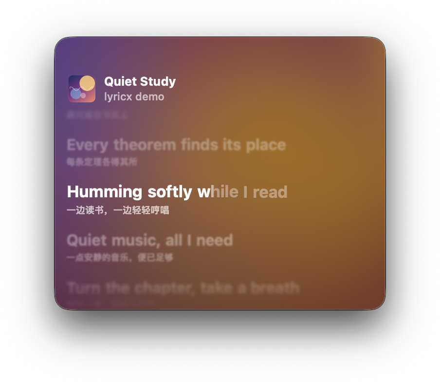
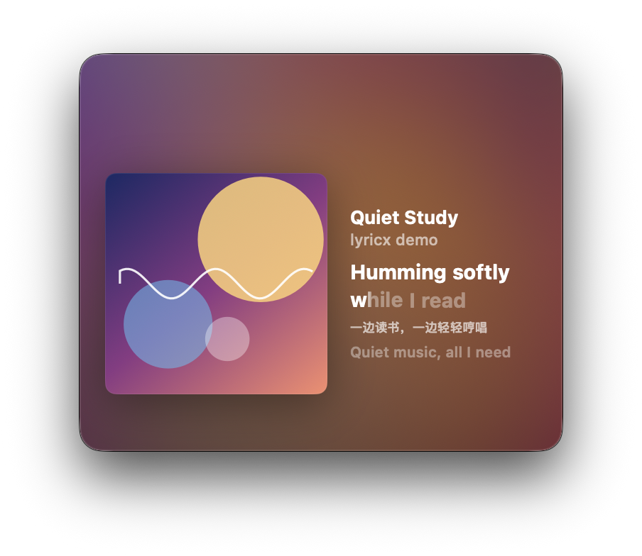
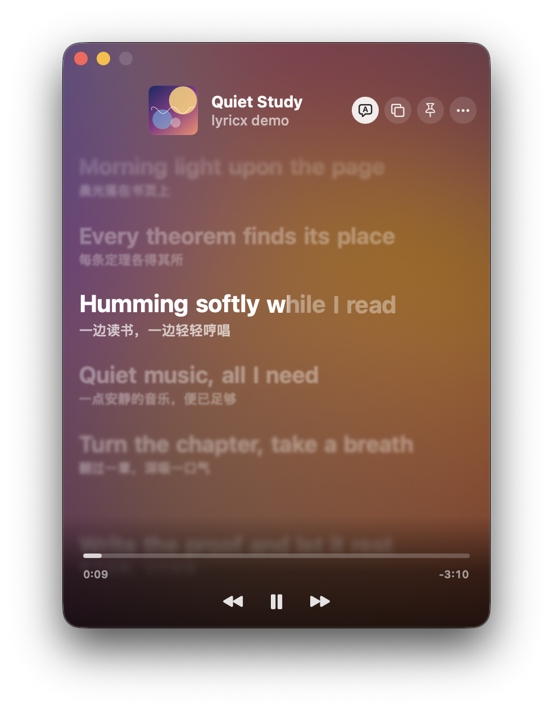
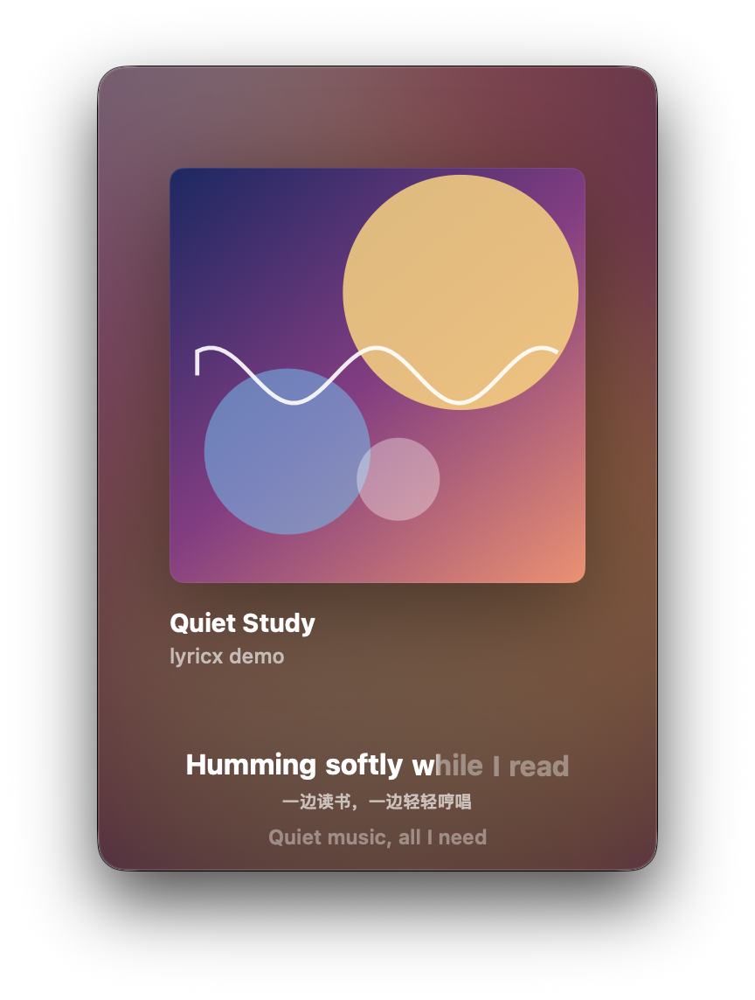

# lyricx

一个只为 **Apple Music** 准备的 macOS 歌词小窗。它是 [LyricsX](https://github.com/MxIris-LyricsX-Project/LyricsX) 的个人精简改版，界面仿照 Apple Music 原生歌词，小窗适合一边看书学习一边听歌。

> 这是个人使用的非官方分支，与原作者和 MxIris-LyricsX-Project 无关。原版功能更全、支持更多播放器，需要的话请使用[原项目](https://github.com/MxIris-LyricsX-Project/LyricsX)。

<table>
  <tr>
    <td align="center"><br>歌词模式 · 小窗，逐字点亮 + 翻译</td>
    <td align="center"><br>欣赏模式 · 横向小窗</td>
  </tr>
  <tr>
    <td align="center"><br>鼠标移入时显示控制按钮和进度条</td>
    <td align="center"><br>欣赏模式 · 竖向</td>
  </tr>
</table>

<sub>配图由仓库里的演示程序生成（`cd LyricsX/LyricsXPackage && swift run StageDemo lyrics 340 280`），歌词是自编的示例句子，封面由程序绘制，不含任何受版权保护的内容。</sub>

## 和原版相比的变化

**界面**

- 重做了歌词窗口，风格接近 Apple Music：
  - 背景是流动的模糊封面；
  - 歌词逐字点亮，长音会轻微发光；
  - 换行时各行依次弹性滚动；
  - 远处的行会虚化；
  - 间奏时显示三个呼吸圆点。
- 有两种模式，按 `M` 切换：
  - **歌词模式**：滚动显示整首歌词，可以显示翻译和背景和声；
  - **欣赏模式**：显示大封面和当前两行歌词。窗口是横向时，自动改成左封面、右歌词。
- 窗口大小只能在菜单里选：小、中、大，或自定义（输入宽高）。拖窗口边缘改不了大小，不会误触。按住窗口任意位置都能拖动它。
- 可以置顶。鼠标移出窗口时，所有控制按钮都会隐藏。

**歌词来源与匹配**

- 新增了 4 个来源：
  - [AMLL TTML DB](https://github.com/Steve-xmh/amll-ttml-db)：人工校对的逐字歌词库，带翻译；
  - 酷我；
  - 咪咕；
  - Deezer：用匿名接口取逐行同步歌词。
- 原有的来源保留：网易云、QQ 音乐、酷狗、LRCLIB、Musixmatch。
- **先判断是不是这首歌**：歌手对不上、并且时长相差超过 2 秒的结果直接丢弃。同名不同歌手的歌不会再被配错。
- **按来源可信度排序**，默认顺序：AMLL → QQ 音乐 → 网易云 → Deezer → 酷狗 → LRCLIB → 酷我 → 咪咕 → Musixmatch。
  - 可在偏好设置里拖动排序，自定义顺序。
  - 排名靠后的来源先返回时，会先等 1.2 秒，看有没有更可信的结果，所以不会先闪一下错的。
- **搜索更宽**：除了原样搜索，还会用「去掉 (Remastered)、feat. 等版本后缀的歌名 + 第一位歌手」再搜一次。比较时会统一繁简、全半角和大小写。
- 自动过滤开头的署名行（作词、作曲、Lyrics by…）和「翻译由某某提供」之类的说明。

**精简**

- 只支持 Apple Music。
- 去掉了以下功能：
  - 桌面歌词；
  - 菜单栏滚动歌词；
  - 触控栏；
  - 自动更新（避免被上游版本覆盖）。
- 菜单栏图标只保留常用操作。

## 安装

到 [Releases](https://github.com/yzysiu777/lyricx/releases/latest) 下载 `lyricx-x.y.z.dmg`。Apple 芯片和 Intel 的 Mac 都能用，需要 macOS 14 以上。

1. 打开 DMG，把 LyricsX 拖进 Applications 文件夹。
2. 本项目没有经过 Apple 公证，第一次打开会被系统拦下。打开「系统设置 → 隐私与安全性」，在页面底部点「仍要打开」。也可以在终端运行：
   ```bash
   xattr -dr com.apple.quarantine /Applications/LyricsX.app
   ```
3. 系统询问是否允许 LyricsX 控制「音乐」时，选择允许。

LyricsX 运行后只在菜单栏显示一个图标，歌词窗口从菜单栏图标里打开。

> 注意：本 App 和原版 LyricsX 使用相同的 Bundle ID，安装后会替换原版，原版的设置会继续沿用。

## 构建

需要 macOS 14 以上和 Xcode 16 以上，不需要 Apple 开发者账号（构建脚本使用 ad-hoc 签名）。

```bash
git clone https://github.com/yzysiu777/lyricx.git
cd lyricx
./scripts/build.sh
```

构建产物在 `dist/LyricsX.app`，拖进「应用程序」文件夹即可。运行 `./scripts/package-dmg.sh` 可以打包通用版（Apple 芯片 + Intel）的 DMG。第一次运行时，系统会请求控制「音乐」App 的权限，请允许。

和原版相比，为了能在本地构建，做了这些改动：

- 去掉了需要开发者描述文件的 iCloud、App Group、钥匙串权限；
- 最低系统版本提到 macOS 14；
- 构建时会给预编译的 Sparkle 框架重新签名。

## 快捷操作

| 操作 | 效果 |
|---|---|
| 空格 | 播放 / 暂停 |
| `T` | 显示 / 隐藏翻译 |
| `M` | 切换歌词模式 / 欣赏模式 |
| 单击一句歌词 | 跳到这一句 |
| 滚轮 | 手动翻看歌词，停手 3 秒后自动回到当前句 |
| 把 `.lrc` 文件拖进窗口 | 导入歌词 |
| 窗口右上角「…」 | 搜索歌词、调整时间偏移、窗口大小、字号等 |

## 目录结构

```
LyricsX/       App 本体（基于 MxIris-LyricsX-Project/LyricsX）
  LyricsXPackage/Sources/LyricsXFoundation/Stage/   新的歌词窗口界面（SwiftUI）
  LyricsXPackage/Sources/StageDemo/                 生成 README 配图的演示程序
LyricsKit/     歌词搜索与解析（基于 MxIris-LyricsX-Project/LyricsKit develop 分支）
MusicPlayer/   播放器接口（MxIris-LyricsX-Project/MusicPlayer，未修改）
scripts/       构建脚本
docs/images/   README 配图
```

本仓库基于以下上游版本：

| 组件 | 上游版本 |
|---|---|
| LyricsX | `d893275`（2026-10-27） |
| LyricsKit | develop 分支 `ffd68cc`（2026-08-29） |
| MusicPlayer | `ced0ac7`（2026-06-21） |

## 致谢

这个项目几乎全部建立在别人的工作上，衷心感谢：

- **[ddddxxx（Xander Deng）](https://github.com/ddddxxx)**：[LyricsX](https://github.com/ddddxxx/LyricsX) 的原作者。从歌词搜索、解析到桌面显示，整个项目的基础都出自他的长期工作。
- **[Mx-Iris](https://github.com/Mx-Iris) 与 [MxIris-LyricsX-Project](https://github.com/MxIris-LyricsX-Project)**：在原项目停止更新后接手维护，适配新版 macOS，并持续改进 LyricsKit（包括本项目用到的 TTML 逐字歌词解析）和 MusicPlayer。本仓库直接基于他们的版本修改。
- LyricsX 的其他贡献者与翻译者。
- **[Steve-xmh](https://github.com/Steve-xmh) 与 [AMLL TTML DB](https://github.com/Steve-xmh/amll-ttml-db) 的所有贡献者**：人工制作和校对了大量高质量的逐字歌词。界面设计也受到他们的 [Apple Music-like Lyrics](https://github.com/Steve-xmh/applemusic-like-lyrics) 项目启发。
- **[LRCLIB](https://lrclib.net)**：开放、免费的同步歌词库。
- 本项目用到的开源库，包括 [Sparkle](https://github.com/sparkle-project/Sparkle)、[MASShortcut](https://github.com/shpakovski/MASShortcut)、[SnapKit](https://github.com/SnapKit/SnapKit)、[SwiftyOpenCC](https://github.com/ddddxxx/SwiftyOpenCC)、[CryptoSwift](https://github.com/krzyzanowskim/CryptoSwift)、[Regex](https://github.com/ddddxxx/Regex)、[swift-async-algorithms](https://github.com/apple/swift-async-algorithms) 等。

本项目的改动是在 [Claude Code](https://claude.com/claude-code) 的协助下完成的。

## 声明

- 歌词版权归词作者、唱片公司和各歌词平台所有。本项目只在本地为个人显示歌词，不存储、不分发歌词内容，请勿用于商业用途。
- 本项目调用的各平台接口都不是官方开放接口，随时可能失效。
- 「Apple Music」是 Apple Inc. 的商标。本项目与 Apple 没有任何关联。

## 许可证

与上游一致，使用 [Mozilla Public License 2.0](LICENSE)。修改过的文件同样以 MPL-2.0 发布，各子目录保留了上游的 LICENSE 文件。
